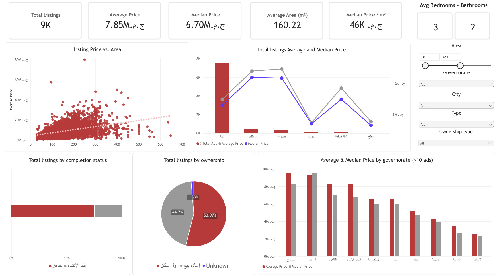
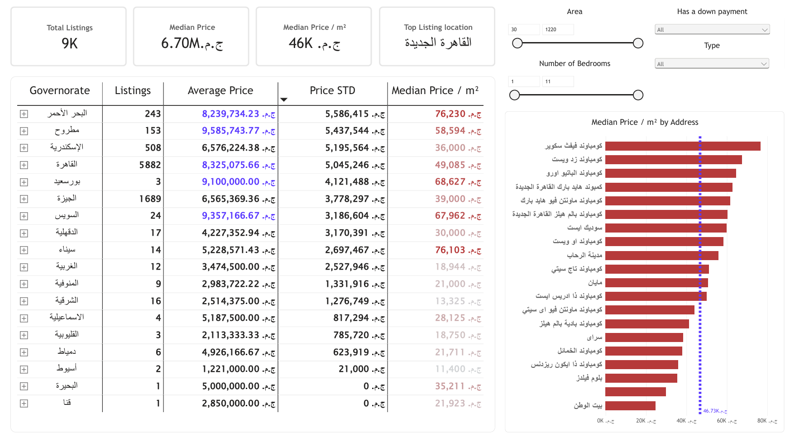
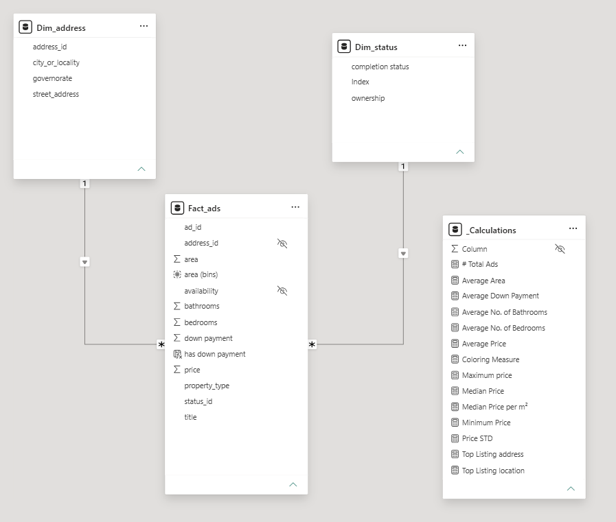

# Egypt Real Estate Listings | End-to-End Data Analytics

**An independently collected and analyzed dataset of apartment and duplex sale listings in Egypt, explored through Python and Power BI.**

This portfolio project examines advertised property prices, sizes, property types, listing status, and geographic differences using public listings from [Dubizzle Egypt](https://www.dubizzle.com.eg/). It demonstrates the workflow from **web data collection** to **data profiling, dimensional modeling, DAX-based KPIs, and interactive reporting**.

> **Scope:** This is an analysis of *advertised asking prices in a scraped sample*, not completed property transactions or a representative survey of Egypt's entire housing market.

## Dashboard preview

**Page 1 — Market overview**



**Page 2 — Property and location explorer**



### Project at a glance

| Item | Details |
| --- | --- |
| Data source | Public Dubizzle Egypt property search results |
| Collection method | Python scraper using HTML parsing and structured JSON-LD |
| Scraped pages | 199 |
| Raw extracted listing rows | **9,148** |
| Distinct listing IDs in raw CSV | **8,826** |
| Raw dataset fields | 19 |
| Currency | Egyptian pounds (EGP) |
| Analysis and reporting | Power BI, Power BI data modeling, and DAX measures |
| Geographic coverage | Egyptian governorates represented in the scraped listings; coverage is uneven |

The figures above describe the supplied **raw CSV**, before any dashboard-specific filtering or transformations. Dashboard KPIs below refer to the supplied **Power BI PDF export** and may therefore differ.

## Objectives and analytical questions

The dashboard was designed to explore:

1. How do advertised property prices vary across governorates, cities, and localities?
2. How different are **average** and **median** asking prices, particularly in segments with expensive listings?
3. What is the relationship between **property area** and **asking price**?
4. Which property types and locations account for most observed listings?
5. How do **completion status**, **ownership**, and disclosed **down payments** differ within the sample?
6. How does **price per square metre** help compare locations with different property sizes?

## Technology stack

| Technology | Purpose |
| --- | --- |
| **Python 3.10+** | Command-line web scraper and structured-data extraction |
| **Python standard library** | `urllib`, `html.parser`, `json`, `csv`, `argparse`, `robotparser`, and request handling; no third-party scraping package required |
| **CSV / JSON-LD** | Raw data output and nested public property attributes |
| **Power BI Desktop** | Interactive reports, filters, data modeling, and visual analysis |
| **DAX** | Measures including listing counts, price statistics, and price-per-m² KPIs |
| **Governorate lookup CSV** | Arabic/English governorate standardization for geographic visuals |

## End-to-end workflow

```text
Public Dubizzle search pages
            |
            v
Python HTTP requests (robots.txt checked)
            |
            v
Parse Schema.org JSON-LD / RealEstateListing records
            |
            v
Export raw listing attributes to UTF-8 CSV
            |
            v
Profile duplicates, missing fields, distributions, and outliers
            |
            v
Prepare and model property, location, and status fields in Power BI
            |
            v
Build DAX measures and interactive dashboard pages
            |
            v
Interpret findings and document limitations
```

### 1. Data collection

The provided `scraping/main.py`:

- Fetches public search-result pages using standard Python HTTP tools.
- Reads and respects `robots.txt` before requesting pages and stops if access is disallowed.
- Parses structured **JSON-LD** listing records (`ListItem` / `RealEstateListing`) embedded in the page HTML.
- Extracts listing identifiers, asking prices, sizes, bedrooms, bathrooms, property types, locations, listing URLs, and public property attributes.
- Removes duplicate listing URLs **within each page** while parsing; the final multi-page CSV can still contain repeated ad IDs across different pages.
- Filters out contact-oriented attribute names, including seller, phone, email, and WhatsApp fields.
- Writes UTF-8-sig CSV, suitable for Arabic text in common spreadsheet tools.
- Uses an adjustable page range and request delay; it does not attempt to bypass access restrictions.

The raw export contains 19 fields:

`page`, `position`, `ad_id`, `title`, `listing_url`, `image_url`, `price`, `currency`, `availability`, `property_type`, `area`, `area_unit`, `bedrooms`, `bathrooms`, `street_address`, `city_or_locality`, `region`, `country`, and `property_attributes_json`.

The JSON attributes contain property details such as **Completion Status**, **Ownership**, and sometimes **Down Payment**.

### 2. Data profiling and preparation

Checks on the supplied raw CSV identified:

| Quality check | Raw-data observation | Analytical implication |
| --- | ---: | --- |
| Total extracted rows | 9,148 | A row is not necessarily a unique ad |
| Unique `ad_id` values | 8,826 | Use unique-ID logic for listing counts |
| Additional occurrences of repeated IDs | 322 | Duplicates can inflate counts and skew price statistics |
| Missing `street_address` | 929 rows | Street-level analysis has incomplete coverage |
| Rows containing a `Down Payment` attribute | 3,286 | Missing disclosure must not be interpreted as a zero payment |
| Area range | 2–5,454 m² | Very small/large values need validation |
| Highest raw asking price | EGP 171.6M | High-end listings can strongly influence averages |

**Data preparation considerations:** standardize Arabic location labels; parse nested attributes; use numeric types and consistent EGP formatting; check repeated ad IDs; identify implausible area/price values; and distinguish missing fields from genuine `False`/zero values. The exact Power Query transformation script and exclusion rules were **not included** with the supplied files, so this README does not assert that a particular cleaning rule has already been applied.

A special geographic ambiguity is the source value **`سيناء`**: it does not specify whether the ad belongs to **North Sinai** or **South Sinai**. These records should be resolved before a governorate-level map is treated as authoritative.

### 3. Data modeling

The provided Power BI model uses a fact/dimension structure:



| Table | Role | Example fields |
| --- | --- | --- |
| `Fact_ads` | Property listing facts | `ad_id`, `price`, `area`, `bedrooms`, `bathrooms`, `property_type`, `address_id`, `status_id`, `down payment` |
| `Dim_address` | Location attributes | `address_id`, `governorate`, `city_or_locality`, `street_address` |
| `Dim_status` | Status descriptions | `Index`, `completion status`, `ownership` |
| `_Calculations` | Centralized DAX measures | Listing count, average/median prices, price standard deviation, price per m², and other summary statistics |

The model diagram shows **one-to-many relationships** from the location and status dimensions into `Fact_ads`. The separate measure table keeps report calculations organized.

### 4. Dashboard pages

**Market overview**

- Cards for total listings, average and median asking prices, average area, median price per m², and bedroom/bathroom indicators.
- Scatter plot showing the association between **listing price** and **area**.
- Combo chart comparing listing volume with average and median prices by property type.
- Visuals for completion status and ownership mix.
- Average-versus-median comparisons across governorates, with a minimum listing-count threshold shown on the chart.
- Slicers for area, governorate, city, property type, and ownership.

**Property and location explorer**

- Expandable governorate table with listing counts, average asking price, standard deviation, and median price per m².
- Ranked localities/compounds by median price per m².
- Filters for area, bedrooms, property type, and down-payment disclosure.

## Selected results

### From the Power BI report snapshot

| Dashboard KPI | Displayed value |
| --- | ---: |
| Total listings | ~9K |
| Average asking price | **EGP 7.85M** |
| Median asking price | **EGP 6.70M** |
| Average area | **160.61 m²** |
| Median asking price per m² | **~EGP 46K** |
| Most common listing locality | **New Cairo (القاهرة الجديدة)** |

These are values displayed in the supplied report PDF, not independently reconstructed results from the Power BI model. They depend on the dashboard's data preparation and filter context.

### From the raw CSV

- **Cairo** accounts for **6,236 of 9,148 extracted rows (~68.2%)**; **Giza** contributes **1,845 (~20.2%)**. Together they represent approximately **88.3%** of raw rows. The dataset therefore heavily overrepresents these areas relative to smaller locations in the export.
- Listings categorized as **apartments (`شقة`)** represent **8,047 of 9,148 rows (~88.0%)**.
- The **raw mean asking price (~EGP 7.93M)** is above the **raw median (EGP 6.70M)**, consistent with a right-skewed price distribution. Median values are especially helpful when comparing unevenly priced segments.
- Down-payment information is present for **3,286 of 9,148 rows (~35.9%)**; absence of that attribute does **not** establish that no down payment is required.

These are **descriptive findings about the collected listings**, not estimates of nationwide property values, affordability, investment return, or actual sale prices.

## Repository structure

```text
Egypt-Real-Estate-Analysis/
├── README.md
├── scraping/
│   └── main.py                         # Python data collector
├── data/
│   ├── egypt_governorates_powerbi.csv  # Full governorate reference
│   └── egypt_governorate_scraped_name_lookup.csv
├── assets/
│   ├── dashboard-overview.png
│   ├── dashboard-details.png
│   └── data-model.png
└── powerbi/
    └── Dubizzle_Apartments_Dashboard.pbix  # Add your original .pbix here
```

**Repository note:** The starter package contains the README, screenshots, scraper, and governorate lookups. Add the original `.pbix` yourself. The full scraped CSV is intentionally not included in the starter package; review the source website's terms and your intended publishing rights before redistributing source records, listing images, or URLs.

## How to run the scraper

Requirements: **Python 3.10+** and access to public pages, subject to the source website's current rules. The supplied Python scraper uses **only the standard library**.

From the repository root, run a small test extraction:

```bash
python scraping/main.py --start-page 1 --end-page 5 --delay 2 --output dubizzle_apartments_sale.csv
```

For an available set of pages, change `--start-page` and `--end-page` as needed. The scraper supports pages **1–199**, respects `robots.txt`, and fails if it cannot find structured listings; changes to the source site can affect results. Use `--overwrite` only when you intentionally want to replace an existing CSV.

```bash
python scraping/main.py --help
```

To explore the dashboard, open your original `powerbi/Dubizzle_Apartments_Dashboard.pbix` in **Power BI Desktop** and ensure its CSV source points to the dataset location on your computer. The `.pbix` file is not part of the provided source files for this README.

## Limitations and responsible interpretation

- **Selection bias:** Results depend on listings returned by Dubizzle search pages, ranking, filters, and the pages collected. They do not represent all properties or all transactions in Egypt.
- **Asking vs. sale price:** Listing prices are seller-advertised asking prices, not verified completed transactions.
- **Repeated advertisements:** The same ad ID may occur on multiple scraped pages; deduplication or distinct counting is essential.
- **No recorded scrape timestamp:** The CSV has a page number but no `scraped_at` field. A time-series analysis would require dated collection snapshots.
- **Missing and inconsistent attributes:** Some listings omit street addresses or down-payment data; status labels and geographic names may need normalization.
- **Extreme values:** Some prices and areas require manual validation or documented inclusion/exclusion rules.
- **Geographic comparability:** Governorates with very few ads should not be treated as equally representative of their local market.
- **Usage and attribution:** This is an independent educational/portfolio project, not affiliated with Dubizzle. Respect robots rules, source terms, and applicable rights when collecting or publishing data.

## Potential extensions

- Document and automate a reproducible raw-to-clean data pipeline.
- Add a cleaned-data validation summary and disclose filtering rules.
- Add a **governorate map** with validated Arabic-to-English geographic names.
- Introduce sample-size-aware locality rankings and consistent median price-per-m² comparisons.
- Collect date-stamped snapshots to analyze changes over time without confusing refreshed ads with genuine price changes.
- Add a short, evidence-based insights narrative alongside the dashboard visuals.

---

**Portfolio focus:** Python data extraction · data quality · dimensional modeling · DAX · Power BI · real estate market exploration · analytical storytelling
